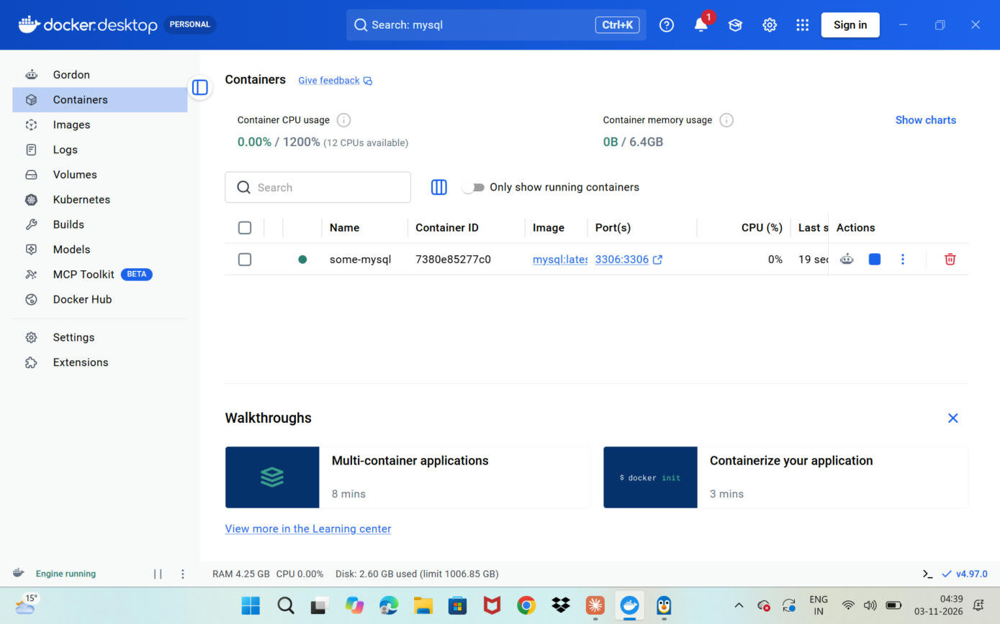
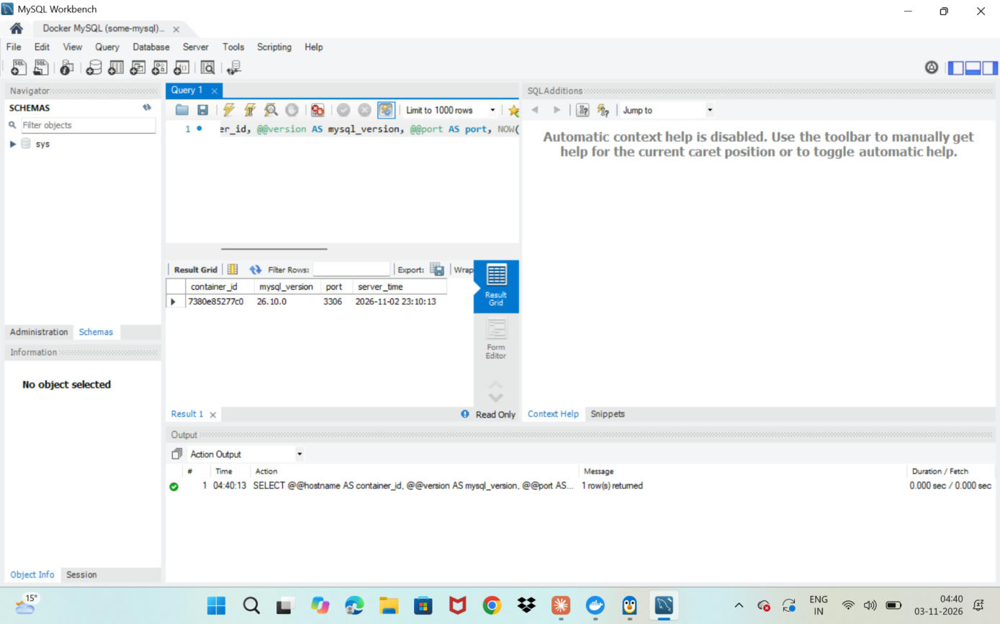
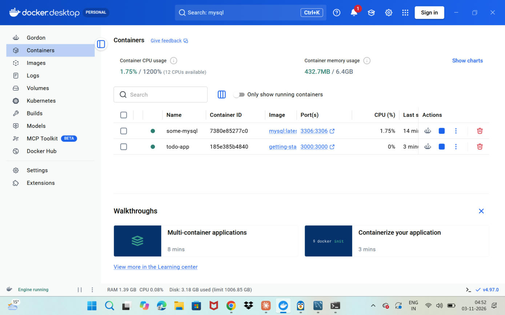
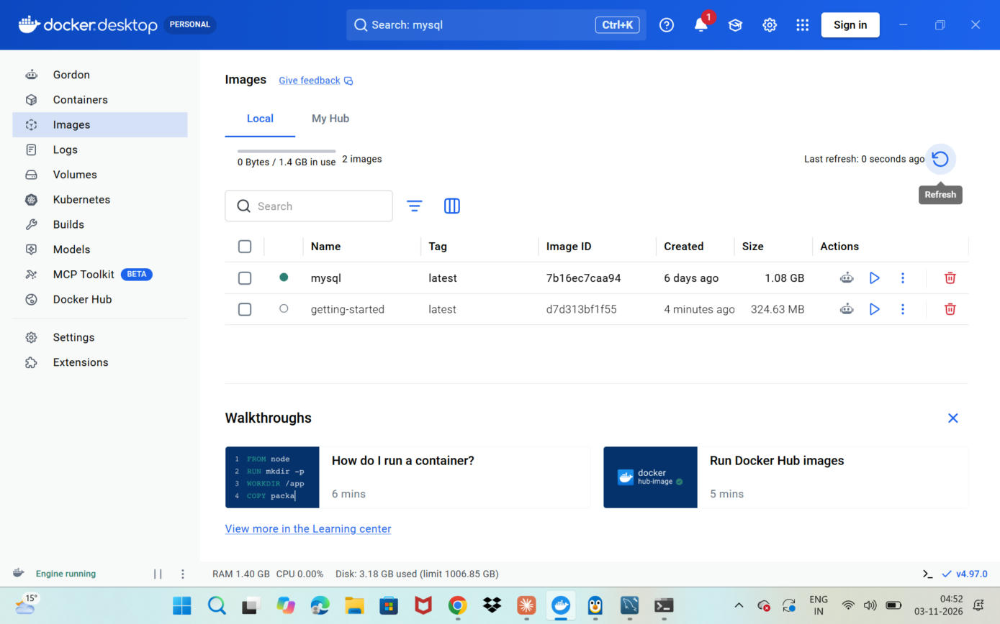
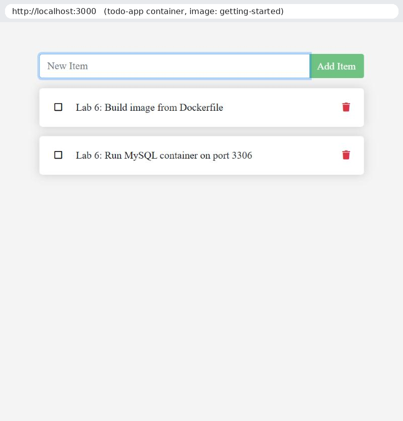

# Lab 6 – Docker & Containerization

Containerizing an application with Docker, and running a MySQL database server in a Docker container that is reachable from the host through port mapping.

## Repository contents

| Path | What it is |
|---|---|
| `getting-started-app/Dockerfile` | Dockerfile written for the Docker "getting started" exercise |
| `getting-started-app/` | Source of the todo app that the image is built from |
| `run-lab.ps1` | PowerShell script with every Docker command used in this lab |
| `screenshots/` | Proof screenshots (Docker Desktop, the running app, MySQL Workbench) |

## 1. Docker Desktop
Docker Desktop is installed on Windows with the WSL 2 backend.

## 2. Dockerfile – build and run an image

```dockerfile
FROM node:lts-alpine
WORKDIR /app
COPY . .
RUN npm ci --omit=dev
CMD ["node", "src/index.js"]
EXPOSE 3000
```

```powershell
cd getting-started-app
docker build -t getting-started .
docker run -d --name todo-app -p 127.0.0.1:3000:3000 getting-started
```
The app is then available at http://localhost:3000.

## 3. MySQL server in Docker

```powershell
docker pull mysql
docker run --name some-mysql -e MYSQL_ROOT_PASSWORD=my-secret-pw -p 3306:3306 -d mysql:latest
```
`-p 3306:3306` maps port 3306 on the laptop (host) to port 3306 in the container, so tools on the host can reach the database.

## 4. MySQL Workbench
A connection to the container is made with these settings:
- Hostname: `127.0.0.1`
- Port: `3306`
- Username: `root`
- Password: the `MYSQL_ROOT_PASSWORD` from the run command

Note: this PC also has a native MySQL 9.2 install. The connection screenshot shows the container ID as the server hostname, confirming the Docker server is the one answering on port 3306.

## Screenshots

### Docker Desktop – MySQL container running (port 3306:3306)


### MySQL Workbench connected to the MySQL container
The query `SELECT @@hostname` returns `7380e85277c0`, which is the Docker container ID – proving Workbench is talking to the MySQL server inside the container through the mapped port 3306.



### Docker Desktop – both containers running (todo app + MySQL)


### Docker Desktop – images (getting-started built from the Dockerfile, mysql pulled)


### Todo app running from the built image at http://localhost:3000


## Key concepts
- **Virtual machine vs. container:** a VM virtualizes hardware and runs a full guest OS; a container shares the host kernel and packages only the app and its dependencies, so it is lighter and starts in seconds.
- **Image vs. container:** an image is the read-only template built from a Dockerfile; a container is a running instance of an image.
- **Port mapping (`-p host:container`):** forwards a port on the host machine to a port inside the container so the service can be reached from outside.
